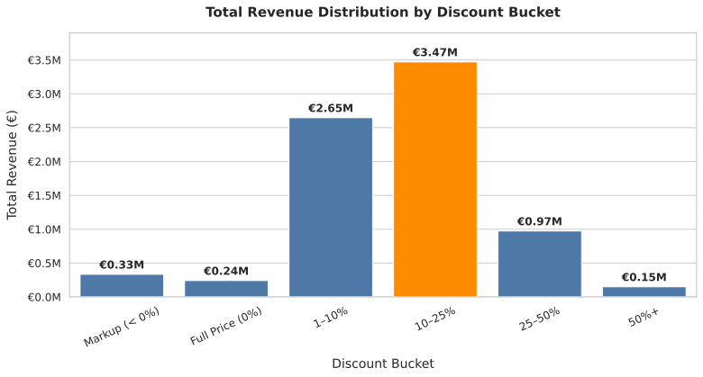
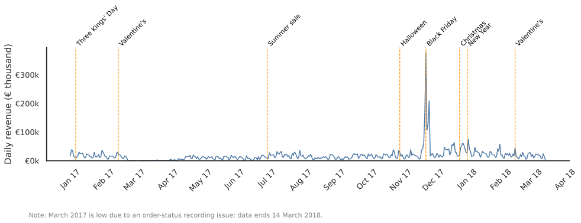
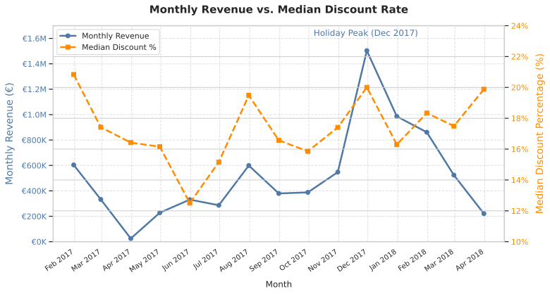
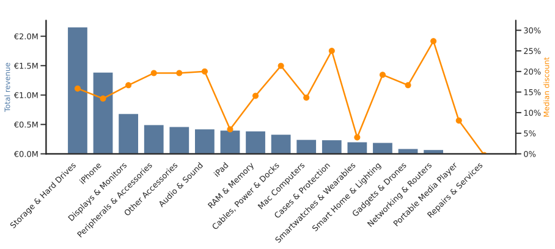
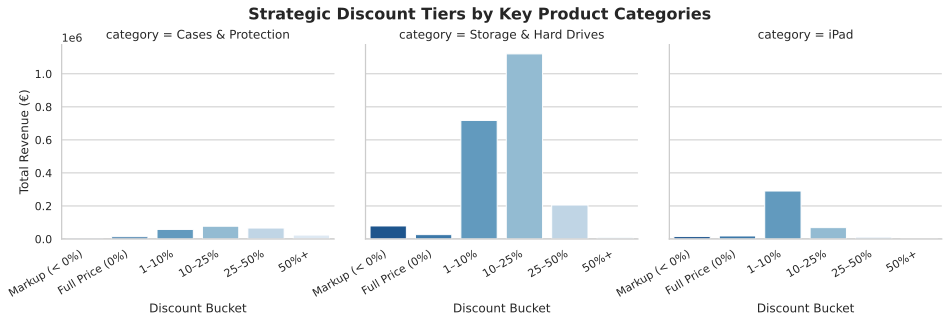
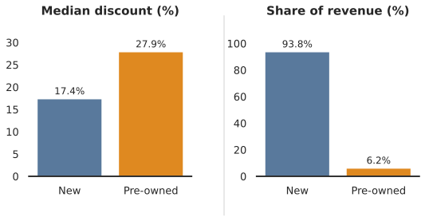

# Eniac Discount Strategy
### Exploratory analysis of discounting, revenue, product categories and seasonality for an online Apple retailer


> **In short:** Discounting at Eniac is the norm, not the exception, but deeper discounts do not bring in more revenue. Moderate discounts of 10–25%, well-timed seasonal promotions and tighter control of pre-owned markdowns offer a more disciplined strategy.

---

## 📑 Table of Contents
1. [Team](#-team)
2. [Deliverables](#-deliverables)
3. [Project Overview](#-project-overview)
4. [Key Findings](#-key-findings)
5. [Visualisations](#-visualisations)
6. [Recommendations](#-recommendations)
7. [Dataset](#-dataset)
8. [Repository Structure](#-repository-structure)
9. [How to Use This Project](#-how-to-use-this-project)
10. [Contact](#-contact)

---

## 👥 Team
Group project completed as part of the **Data Analytics & AI program at WBS Coding School**.

| Name | GitHub |
|---|---|
| Sahana Varadharajan | [@sahana-varadharajan](https://github.com/sahana-varadharajan) |
| Sweta Khandelwal | [@Sweta-Khandelwal](https://github.com/Sweta-Khandelwal) |
| Shardul Vedpathak | [@Shardul0044](https://github.com/Shardul0044) |

---

## 📦 Deliverables

| Deliverable | Description |
|---|---|
| 📊 [Presentation deck](documents/eniac_discount_strategy_presentation.pdf) | Final board presentation with findings and recommendations |
| 📝 [Exploratory analysis log](documents/eniac_exploratory_analysis_log.pdf) | Step-by-step record of observations during the analysis |
| 💻 [Jupyter notebook](script/eniac_discount_strategy.ipynb) | Data cleaning, EDA and visualisation code |
| 🗂️ [Datasets](data/) | Raw source files and cleaned tables |

---

## 🧭 Project Overview

### Business Context
Eniac is an online retailer selling Apple products and compatible accessories, from flagship devices to storage, cables, cases and networking equipment. Discounts are used across almost the entire catalogue, which makes it hard to tell whether a sale is driven by a promotion, a standing markdown or simply the time of year.

### Business Question
> Do deep or frequent discounts actually drive higher revenue for Eniac, and what would a more disciplined discount strategy look like?

### Approach
1. **Data cleaning:** resolved duplicate SKUs, missing values, dates stored as text and corrupted price formats; kept only completed orders
2. **Exploratory analysis:** revenue by discount level, product category, item condition (new vs. pre-owned) and time
3. **Seasonality analysis:** compared revenue in peak sale periods (Black Friday/Cyber Week, Christmas, New Year) against the off-season
4. **Strategy:** translated the findings into recommendations presented to a simulated board

---

## 🔑 Key Findings

- **Discounting is the default.** Around **93%** of items sold below their shelf price. Most revenue came from the **10–25%** discount range (~€3.47M, ~44.4%) and the **1–10%** range (~€2.65M, ~33.9%).
- **Bigger discounts ≠ more revenue.** Discounts of **50% or more** produced only ~**1.9%** of revenue (~€0.15M). Flagship products such as iPads sold well with light discounts of 1–10%.
- **Seasonality shapes the year.** Revenue rose sharply around **Black Friday/Cyber Week** and the **December holidays**, then slowed into spring. Peak sale periods brought in ~€4.93M of the ~€7.82M total.
- **Pre-owned items are discounted harder but earn little.** Pre-owned products had a median discount of ~**27.9%** (vs. ~17.4% for new items) yet made up only ~**6.2%** of revenue.

---

## 📈 Visualisations

### Revenue by Discount Level


Revenue is concentrated in the 1–10% and 10–25% discount ranges; discounts of 50% and above add very little.

### Seasonality of Discounted Sales


Clear revenue peaks around Black Friday/Cyber Week and the December holidays, compared with a lower off-season baseline.

### Monthly Revenue vs. Median Discount


Months with higher revenue are not simply the months with the deepest discounts.

### Category Revenue and Discount Tiers
<table>
  <tr>
    <td></td>
    <td></td>
  </tr>
</table>

Discount behaviour varies by category, which supports setting discount limits per category rather than one rule for all.

### New vs. Pre-Owned Products


Pre-owned items carry steeper discounts but contribute only a small share of revenue.

> The paid-vs-shelf-price chart and further visuals are in [`images/`](images/) and in the [presentation deck](documents/eniac_discount_strategy_presentation.pdf).

---

## 💡 Recommendations

| Area | What we found | Recommended action |
|---|---|---|
| **Discount frequency** | ~93% of items sell below shelf price, mostly at 1–25% off | Reduce constant discounting and protect full-price sales where demand is already strong |
| **Discount depth** | 50%+ discounts bring ~1.9% of revenue; flagships sell well at 1–10% | Use 10–25% as the standard range and cap most discounts at 25%, with rare exceptions |
| **Pre-owned stock** | Higher median discount (~27.9%) but only ~6.2% of revenue | Move pre-owned items into a controlled discount tier instead of heavy markdowns |
| **Seasonality** | Revenue peaks in late November and December, then slows into spring | Run a targeted post-holiday sale in February to clear excess stock before March |

---

## 🗃️ Dataset

| | |
|---|---|
| **Source** | Eniac sales database, provided by WBS Coding School |
| **Tables** | `orders`, `orderlines`, `products`, `brands` |
| **Total revenue analysed** | ~€7.82M (~€4.93M peak season, ~€2.88M off-season) |

**Key variables**
- `orders`: order ID, timestamp, status, order total
- `orderlines`: quantity, price paid, item-level discount
- `products`: product ID, shelf price, category, new vs. pre-owned
- `brands`: brand reference data

**Cleaning decisions**
- Fixed duplicate SKUs, missing values, text-formatted dates and corrupted prices (e.g. numbers with multiple dots)
- Included only **completed** orders; pending, cancelled and abandoned-cart orders were excluded

**Limitations**
- No product cost data, so all figures show **gross revenue**, not profit
- March 2017 volume is unusually low because of a gap in order-status records
- Data ends on 14 March 2018, so March 2018 is incomplete

---

## 📁 Repository Structure
```
eniac_discount_strategy/
├── data/
│   ├── raw/                  # original source CSVs (large files zipped)
│   └── cleaned/              # cleaned orders, orderlines, products (large files zipped)
├── documents/
│   ├── eniac_discount_strategy_presentation.pdf
│   └── eniac_exploratory_analysis_log.pdf
├── images/                   # charts (01–07)
├── script/
│   └── Eniac_Discount_Strategy_Assessment.ipynb
└── README.md
```

---

## ▶️ How to Use This Project
1. **Quick overview:** open the [presentation deck](documents/eniac_discount_strategy_presentation.pdf) for the findings and recommendations.
2. **Detailed walkthrough:** read the [exploratory analysis log](documents/eniac_exploratory_analysis_log.pdf).
3. **Reproduce the analysis:** unzip any `.zip` files in `data/` first, then open `script/eniac_discount_strategy.ipynb` in Jupyter Notebook or Google Colab and run the cells in order.

> **Note:** Copies of the raw and cleaned data are also stored in `data/`. Some are zipped because they exceed GitHub's 25 MB upload limit; unzip them before use if you want to work with the files locally.

---

## 📫 Contact
**Sahana Varadharajan**
[LinkedIn](https://linkedin.com/in/sahana-varadharajan) · sahana.varadharajan97@gmail.com
